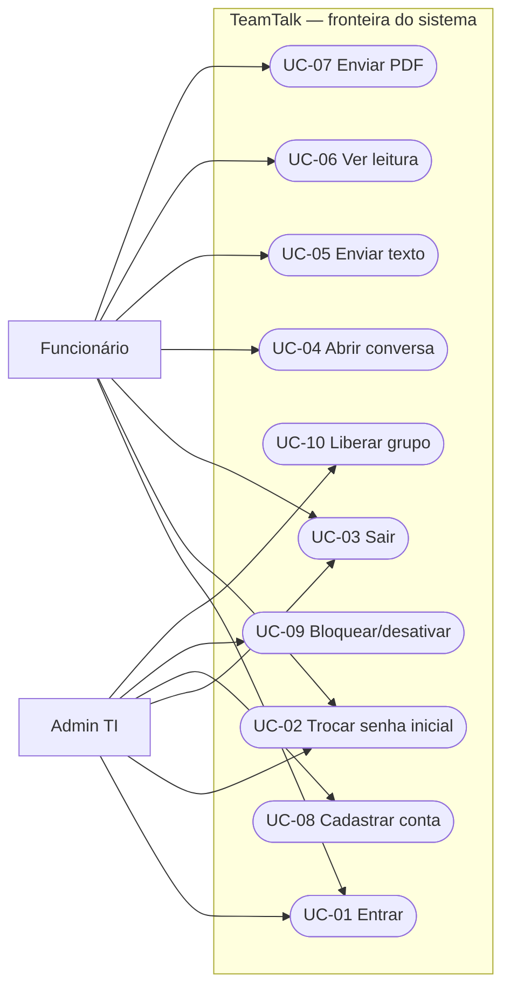

# 4. Casos de uso

## 4.1 Atores e fronteira

- **Funcionário:** usuário cadastrado, ativo, liberado, com senha já trocada.
- **Admin TI:** usuário com papel `it_admin`, ativo e com senha trocada. A liberação e a administração são verificadas no servidor.
- **Supabase Auth/PostgreSQL:** serviços de apoio, não atores humanos.

Os casos descrevem o produto requisitado. Nem todo caso já tem implementação.

## 4.2 Diagrama de casos de uso

## 4.3 UC-01 · Entrar

- **Ator:** Funcionário ou Admin TI.
- **Pré-condição:** conta existente; navegador admitido pela restrição de dispositivo.
- **Fluxo principal:** (1) abrir `/login`; (2) preencher usuário/e-mail e senha; (3) autenticar no Supabase Auth; (4) validar `getUser`, status, grupo, sessão e papel; (5) continuar ou encaminhar para a troca inicial.
- **Fluxos alternativos:** senha inválida → erro; conta não autorizada → acesso negado; sessão vencida → novo login; desktop → tela de bloqueio; primeiro acesso → UC-02.
- **Requisitos:** RF01, RF03, RF07, RF14, RN03, RN05, RNF02, SEG01, SEG06.

## 4.4 UC-02 · Trocar senha no primeiro acesso

- **Ator:** Funcionário ou Admin TI.
- **Pré-condição:** sessão válida, conta autorizada e `must_change_password=true`.
- **Fluxo principal:** (1) abrir `/primeiro-acesso`; (2) preencher nova senha e confirmação; (3) validar no servidor; (4) atualizar senha no Auth; (5) trigger remove a marca; (6) encerrar sessão globalmente e voltar ao login.
- **Fluxos alternativos:** confirmação diferente, senha curta/longa ou igual à antiga → erro; conta bloqueada ou sessão expirada → negar e redirecionar.
- **Requisitos:** RF06, RN04, RNF05, RNF06, SEG02, SEG06.

## 4.5 UC-03 · Sair

- **Ator:** Funcionário ou Admin TI.
- **Pré-condição:** sessão autenticada.
- **Fluxo principal:** (1) acionar Sair; (2) servidor encerra sessão local; (3) navegar para `/login`.
- **Fluxos alternativos:** sessão já expirada → encaminhar ao login; falha de comunicação → não presumir encerramento até o serviço responder.
- **Requisitos:** RF07, RNF06, SEG06.

## 4.6 UC-04 · Abrir conversa

- **Ator:** Funcionário.
- **Pré-condição:** status ativo, grupo habilitado, troca concluída e participação na conversa.
- **Fluxo principal previsto:** (1) listar conversas autorizadas; (2) escolher uma; (3) servidor consulta participantes; (4) RLS retorna apenas histórico permitido.
- **Fluxos alternativos:** não participante → acesso negado; grupo desabilitado ou conta bloqueada → negar; sem mensagens → lista vazia.
- **Requisitos:** RF08, RF09, RF14, RN05, RNF12, SEG04. **Pendente:** fluxo completo de chat.

## 4.7 UC-05 · Enviar texto

- **Ator:** Funcionário.
- **Pré-condição:** conversa autorizada e sessão válida.
- **Fluxo principal previsto:** (1) escrever texto; (2) enviar; (3) servidor valida identidade e participação; (4) persistir `messages` com `message_type=text`; (5) distribuir atualização aos participantes.
- **Fluxos alternativos:** texto vazio → rejeitar; conversa alheia → negar; indisponibilidade → informar falha, sem afirmar envio concluído.
- **Requisitos:** RF08, RF09, RNF08, RNF12, SEG04. **Pendente:** envio/recebimento.

## 4.8 UC-06 · Ver status de leitura

- **Ator:** Funcionário remetente.
- **Pré-condição:** mensagem enviada e participante destinatário autorizado.
- **Fluxo principal previsto:** (1) destinatário abre a mensagem; (2) servidor registra `message_reads`; (3) remetente vê `enviada` ou `lida` conforme registro.
- **Fluxos alternativos:** mensagem ainda não visualizada → manter `enviada`; usuário não participante → não expor status.
- **Requisitos:** RF10, RN08, RNF12, SEG04. **Pendente:** gravação e interface de leitura.

## 4.9 UC-07 · Enviar PDF

- **Ator:** Funcionário.
- **Pré-condição:** conversa autorizada e política de upload definida.
- **Fluxo principal previsto:** (1) selecionar PDF; (2) servidor validar extensão, MIME, conteúdo real e tamanho; (3) armazenar em área privada; (4) registrar mensagem `pdf` e disponibilizar apenas aos participantes.
- **Fluxos alternativos:** outro formato ou PDF falso → rejeitar; acima do limite → rejeitar; não autorizado → negar. **Limite: a definir com o cliente.**
- **Requisitos:** RF11, RF12, RN06, RN07, RNF11, RNF12, SEG05. **Pendente:** upload e download.

## 4.10 UC-08 · Cadastrar conta

- **Ator:** Admin TI.
- **Pré-condição:** conta de TI válida, autorizada e com senha alterada.
- **Fluxo principal previsto:** (1) abrir gestão; (2) informar dados do funcionário; (3) servidor validar `exigirAdminTI()`; (4) criar credencial individual no Auth e perfil `pending`; (5) encaminhar orientações iniciais pelo canal corporativo aprovado.
- **Fluxos alternativos:** funcionário tenta operação → 403; e-mail duplicado → rejeitar; falha no envio → informar erro sem expor segredo.
- **Requisitos:** RF04, RF05, RF13, RN01, RN02, RN03, RN10, SEG02, SEG04. **Pendente:** gestão de cadastro.

## 4.11 UC-09 · Bloquear ou desativar conta

- **Ator:** Admin TI.
- **Pré-condição:** autorização administrativa válida e conta-alvo existente.
- **Fluxo principal previsto:** (1) selecionar usuário; (2) escolher `blocked` ou `disabled`; (3) servidor autorizar; (4) persistir estado e auditoria; (5) negar acesso subsequente ao usuário.
- **Fluxos alternativos:** usuário sem permissão → negar; conta ausente → erro; falha de persistência → não informar conclusão.
- **Requisitos:** RF13, RF14, RN05, RN10, RNF07, SEG04, SEG07. **Pendente:** escrita administrativa.

## 4.12 UC-10 · Liberar grupo

- **Ator:** Admin TI.
- **Pré-condição:** empresa aprovou o grupo e Admin TI tem sessão válida.
- **Fluxo principal previsto:** (1) selecionar grupo; (2) vincular funcionários; (3) habilitar grupo; (4) persistir alteração e auditoria; (5) novas consultas respeitam o estado de liberação.
- **Fluxos alternativos:** grupo não aprovado → não liberar; funcionário fora do grupo → continuar sem acesso; operação não autorizada → 403.
- **Requisitos:** RF15, RN09, RN10, RNF07, SEG04, SEG07. **Pendente:** gestão de grupos; estrutura e RLS já existem.
