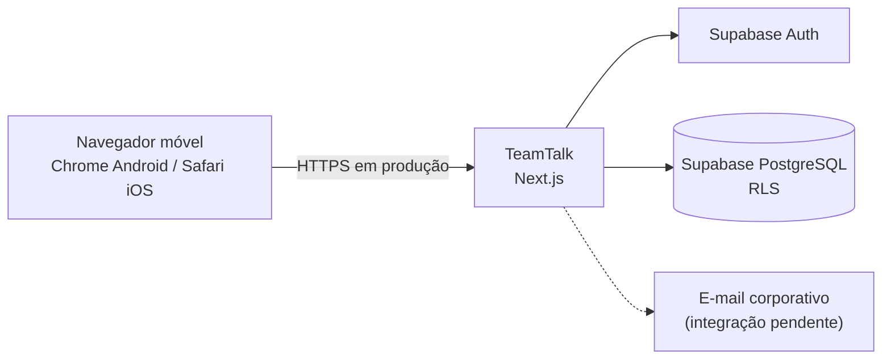
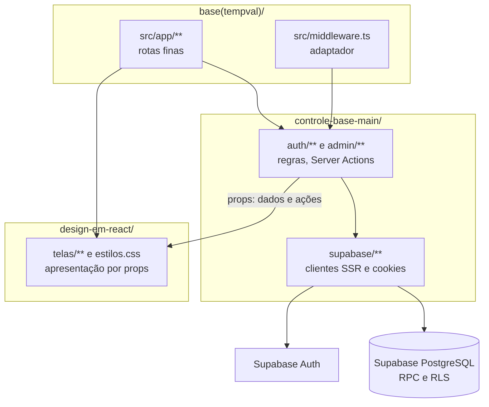
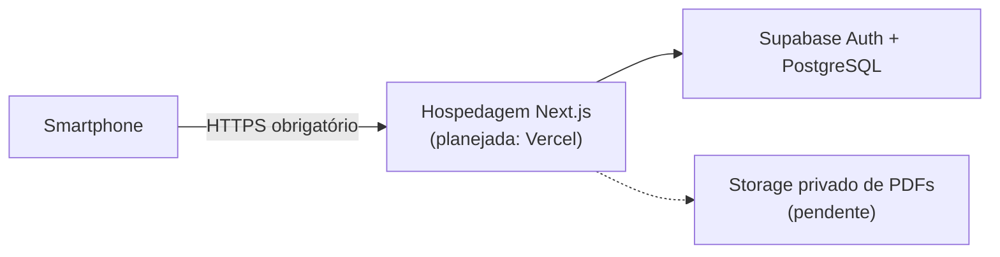

# 5. Arquitetura e execução

## 5.1 Visão geral

TeamTalk utiliza aplicação Next.js com regras em TypeScript e persistência/autenticação Supabase. A arquitetura de três pastas mantém a camada de apresentação isolada do banco. Mensagens realtime, PDF e administração integral fazem parte do plano, mas não estão completas na base examinada.

### Diagrama de contexto



## 5.2 Tecnologias

| Item | Escolha e situação |
|---|---|
| Aplicação | Next.js 15, App Router, React 19 e TypeScript, presentes no `package.json` do workspace. |
| Identidade e sessão | Supabase Auth, `@supabase/ssr` e cookies. |
| Dados | Supabase PostgreSQL, migrations e RLS. |
| Testes existentes | Vitest em funções puras de autenticação, rota, senha e dispositivo. |
| Interface atual | Componentes React em `design-em-react/` e `estilos.css`. |
| Evoluções planejadas | Supabase Realtime; armazenamento privado de PDF; Tailwind/design system; Playwright, Vercel e monitoramento previstos em `DIVISAO_TAREFAS.md`, não confirmados como integrados/deployados. |

## 5.3 Componentes e responsabilidades

A **regra das três pastas** define:

1. `base(tempval)/`: workspace Next, rotas App Router, middleware de entrada, configurações e migrations. As rotas são finas.
2. `controle-base-main/`: regras de autenticação, autorização, decisão de acesso, Server Actions e clientes Supabase.
3. `design-em-react/`: telas e estilos. Recebe somente dados e funções via props; não consulta Supabase.



## 5.4 Navegação e estado

A requisição percorre: navegador → middleware fino de `base(tempval)/` → `controle-base-main/auth/middleware.ts` → verificação do dispositivo → cliente SSR/Supabase → `auth.getUser()` e `get_access_state()` → `decidirAcesso` e `decidirRota` → rota fina → função de controle → tela por props. Uma API protegida precisa validar autorização na operação, além do middleware.

## 5.5 Contrato entre camadas

- A rota encaminha parâmetros e renderiza a tela. Não coloca regra de autorização na página.
- O controle consulta Supabase no servidor e fornece dados e callbacks explícitos à apresentação.
- A tela não deve chamar Supabase nem receber segredo de servidor.
- `exigirAdminTI()` deve ser chamado por **cada** página, API e Server Action administrativa, não apenas pelo middleware.
- Identificadores de campos, APIs e eventos devem ser publicados antes de novas integrações de chat.

## 5.6 Segurança

1. O middleware bloqueia identificação de desktop antes de acessar Supabase. `Sec-CH-UA-Platform`, quando presente, só admite Android. Sem esse cabeçalho, User-Agent admite Android, iPhone ou iPod. iPad/desktop são bloqueados conforme regra atual.
2. User-Agent e Client Hints são falsificáveis; isso **não** substitui autenticação nem autorização.
3. `auth.getUser()` valida o usuário no servidor; `get_access_state()` retorna `authorized`, `must_change_password` e `it_admin`.
4. `decidirAcesso` usa os métodos `amr` para expiração; `decidirRota` define redirecionamento ou erro JSON em API.
5. Supabase SSR guarda a sessão em cookies. O servidor configura `Secure` em produção e `SameSite=Lax`. Não usar `service_role` no navegador.
6. RLS restringe leitura de conversas/mensagens a participantes autorizados e com senha trocada; TI não recebe acesso implícito a chats privados.
7. Gravações futuras (cadastro, chat, PDF e auditoria) devem implementar guardas, validação e políticas específicas. As migrations atuais não liberam escrita direta de cliente.

## 5.7 Executar localmente

Pré-requisitos documentados: Node.js, npm, Docker e Supabase CLI (via `npx`). Os comandos são executados no terminal; `.env.local` nunca deve ser enviado ao repositório.

```sh
# Raiz do repositório
npm install
cd 'base(tempval)'
cp .env.example .env.local
npx supabase start
npx supabase status
# Preencher .env.local com URL e chave pública locais
npm run db:reset
npm run typecheck
npm run lint
npm test
npm run build
npm run dev
```

Abra `http://localhost:3000/login` usando User-Agent móvel real ou simulado. Teste o bloqueio de desktop separadamente. Variáveis públicas locais: `NEXT_PUBLIC_SUPABASE_URL` e `NEXT_PUBLIC_SUPABASE_ANON_KEY`. `SESSAO_MAX_HORAS` controla a validade absoluta da sessão; a implementação usa **12 horas** quando não definido, valor técnico atual e não meta de desempenho do cliente.

## 5.8 Configuração remota e publicação



Os serviços de hospedagem e e-mail previstos no planejamento não têm implantação de produção demonstrada pelas fontes. HTTPS é exigência de produção. O servidor de desenvolvimento local pode usar HTTP.

## 5.9 Limites operacionais

- **A definir com o cliente:** tamanho máximo do PDF, metas de latência e disponibilidade, retenção de mensagens/documentos, versões de navegador suportadas.
- A estimativa de **900 funcionários** é dimensão de planejamento, não resultado de teste de carga.
- A presença de tabelas e políticas não comprova que chat, upload ou painel CRUD estejam finalizados.
