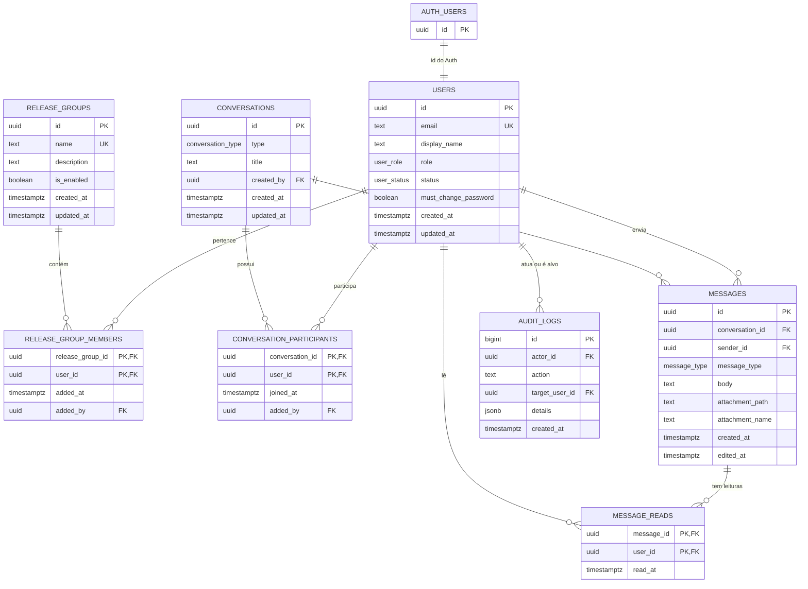

# 6. Modelo e dicionário de dados

## 6.1 Modelo conceitual

A identidade é mantida em `auth.users` pelo Supabase Auth. O perfil, o grupo de liberação, o chat e a auditoria ficam no schema `public`. As quatro migrations da `main` definem as tabelas, funções, triggers, políticas de leitura e controle do primeiro acesso.

## 6.2 Modelo físico e chaves

As tabelas a seguir constam de `20261110000000_initial_schema.sql`. `PK` = chave primária; `FK` = chave estrangeira; `UQ` = única; `NN` = não nulo. Campos opcionais aceitam nulo.

### `public.users`

| Campo | Tipo / restrição |
|---|---|
| `id` | uuid PK, FK → `auth.users.id`, exclui em cascata. |
| `email` | text NN, UQ. |
| `display_name` | text NN, não vazio após trim. |
| `role` | `user_role` NN, padrão `employee`. |
| `status` | `user_status` NN, padrão `pending`. |
| `must_change_password` | boolean NN, padrão `true`. |
| `created_at`, `updated_at` | timestamptz NN; atualização automática de `updated_at`. |

### `public.release_groups`

| Campo | Tipo / restrição |
|---|---|
| `id` | uuid PK, gerado. |
| `name` | text NN, UQ, não vazio. |
| `description` | text opcional. |
| `is_enabled` | boolean NN, padrão `false`. |
| `created_at`, `updated_at` | timestamptz NN; `updated_at` automático. |

### `public.release_group_members`

| Campo | Tipo / restrição |
|---|---|
| `release_group_id` | uuid PK composta, FK → `release_groups.id`, cascata. |
| `user_id` | uuid PK composta, FK → `users.id`, cascata. |
| `added_at` | timestamptz NN. |
| `added_by` | uuid FK → `users.id`, `ON DELETE SET NULL`. |

### `public.conversations`

| Campo | Tipo / restrição |
|---|---|
| `id` | uuid PK, gerado. |
| `type` | `conversation_type` NN, padrão `direct`. |
| `title` | text opcional; obrigatório se `type=group`. |
| `created_by` | uuid FK → `users.id`, `SET NULL`. |
| `created_at`, `updated_at` | timestamptz NN; `updated_at` automático. |

### `public.conversation_participants`

| Campo | Tipo / restrição |
|---|---|
| `conversation_id` | uuid PK composta, FK → `conversations.id`, cascata. |
| `user_id` | uuid PK composta, FK → `users.id`, cascata. |
| `joined_at` | timestamptz NN. |
| `added_by` | uuid FK → `users.id`, `SET NULL`. |

### `public.messages`

| Campo | Tipo / restrição |
|---|---|
| `id` | uuid PK, gerado. |
| `conversation_id` | uuid NN, FK → `conversations.id`, cascata. |
| `sender_id` | uuid NN, FK → `users.id`, `ON DELETE RESTRICT`. |
| `message_type` | `message_type` NN, padrão `text`. |
| `body` | text, obrigatório e não vazio para `text`. |
| `attachment_path`, `attachment_name` | text, obrigatórios para `pdf`. |
| `created_at` | timestamptz NN. |
| `edited_at` | timestamptz opcional. |

`messages_payload_matches_type` exige texto sem anexo para `text` ou caminho/nome e corpo nulo para `pdf`. Não valida bytes de PDF nem concede acesso ao Storage.

### `public.message_reads`

| Campo | Tipo / restrição |
|---|---|
| `message_id` | uuid PK composta, FK → `messages.id`, cascata. |
| `user_id` | uuid PK composta, FK → `users.id`, cascata. |
| `read_at` | timestamptz NN. |

### `public.audit_logs`

| Campo | Tipo / restrição |
|---|---|
| `id` | bigint identity PK. |
| `actor_id` | uuid FK → `users.id`, `SET NULL`. |
| `action` | text NN, não vazia. |
| `target_user_id` | uuid FK → `users.id`, `SET NULL`. |
| `details` | jsonb NN, padrão `{}`. |
| `created_at` | timestamptz NN. |

## 6.3 Tipos, índices e funções

- Enums: `user_role = employee | it_admin`; `user_status = pending | active | blocked | disabled`; `conversation_type = direct | group`; `message_type = text | pdf`.
- Índices secundários: vínculos de grupo por `user_id`, participantes por `user_id`, mensagens por conversa/data e remetente, leituras por `user_id`, auditoria por data e alvo.
- Triggers: criação do perfil `public.users` após novo `auth.users`; `updated_at` em usuários, grupos e conversas; limpeza de `must_change_password` quando `auth.users.encrypted_password` muda de fato.
- RPCs/funções: `is_active_authorized_user()`, `is_active_it_admin()`, `can_access_conversation(uuid)`, `can_access_message(uuid)`, `get_access_state()`. Execução das funções de autorização é concedida a `authenticated`, não a `anon` ou `PUBLIC`.

## 6.4 Dicionário de acesso RLS

A migration inicial habilita RLS nas **oito tabelas**. As migrations seguintes substituem políticas de chat por versões mais restritivas. As políticas abaixo são as **efetivas após as quatro migrations**.

| Tabela / política SELECT | Quem pode ler |
|---|---|
| `users_select_self_or_admin` | Próprio perfil ou Admin TI ativo com senha trocada. |
| `release_groups_select_active_members` | Membro ativo do grupo habilitado ou Admin TI válido. |
| `release_group_members_select_self_or_admin` | Próprios vínculos ou Admin TI válido. |
| `conversation_participants_select_authorized_conversation` | Participante autorizado da própria conversa, com senha trocada. |
| `conversations_select_authorized_participant` | Participante autorizado, com senha trocada. |
| `messages_select_authorized_participant` | Participante autorizado da conversa, com senha trocada. |
| `message_reads_select_authorized_participant` | Participante autorizado da conversa da mensagem, com senha trocada. |
| `audit_logs_select_admin_only` | Somente Admin TI válido. |

**Não há políticas de INSERT, UPDATE ou DELETE para clientes autenticados nessas migrations.** Gravações futuras precisam de autorização confiável e políticas/serviços apropriados. A seleção do próprio perfil em `users` não deve ser confundida com autorização para entrar no chat.

## 6.5 Autorização e isolamento

`is_active_authorized_user()` exige `status=active` e, para `employee`, vínculo com grupo habilitado. `it_admin` ativo não precisa de grupo para função administrativa. `can_access_conversation()` exige também participante e `must_change_password=false`. A TI **não** recebe acesso implícito a mensagens privadas. Bloqueio, desativação ou desabilitação do grupo revogam leitura nas consultas seguintes.

## 6.6 Ciclo de vida e classificação

Dados de identidade vivem no Auth e no perfil público; dados de mensagem e leitura são privados dos participantes; ações administrativas são restritas à TI. Não há política de retenção de mensagens/anexos nas migrations. **Retenção: a definir com o cliente.**

## 6.7 Glossário

- **RLS:** Row Level Security; filtro de linha aplicado pelo PostgreSQL.
- **RBAC:** autorização por papel, `employee` ou `it_admin`.
- **RPC:** função PostgreSQL invocada pela API do Supabase.
- **PK composta:** identificador formado por mais de uma coluna.
- **Auth:** serviço que guarda e valida credenciais.
