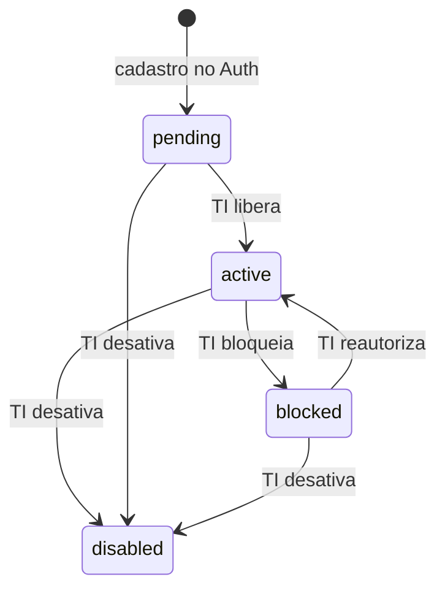
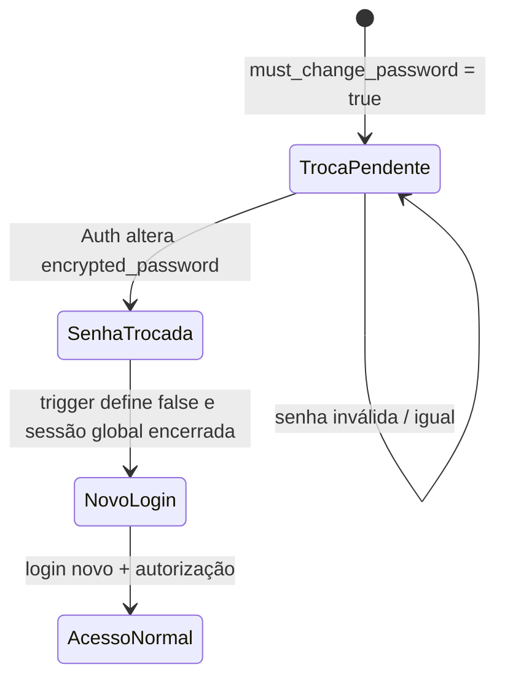
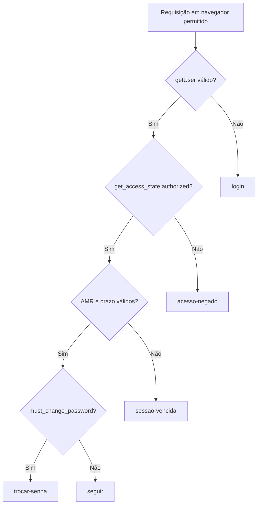
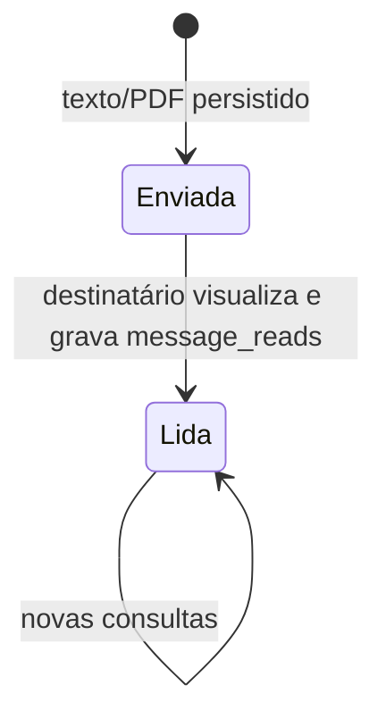
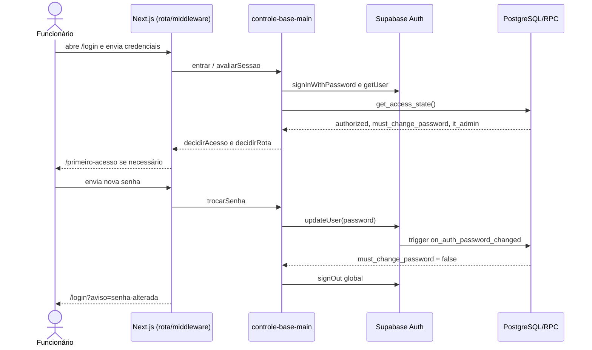
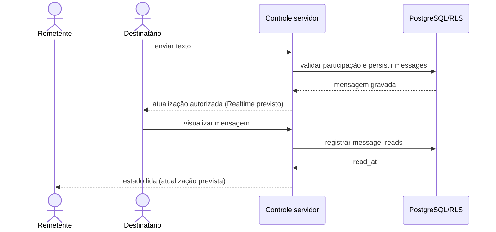

# 7. Diagramas de fluxos e estados

## 7.1 Estados da conta

`users.status` aceita exatamente `pending`, `active`, `blocked` e `disabled`. A migration estabelece os valores, **não** uma máquina de transições obrigatórias. O diagrama representa as operações planejadas pela TI.

- `pending`: perfil criado, aguardando autorização.
- `active`: pode prosseguir **somente** se demais requisitos de liberação estiverem satisfeitos.
- `blocked` e `disabled`: acesso negado.
- A gestão de transições no painel é **pendente**; o enum e as verificações já existem.

## 7.2 Primeiro acesso

A mudança para `false` ocorre por trigger após alteração real da senha no Auth, não por botão do navegador. Quando a TI redefinir senha no futuro, deve tornar a marcar `true` **depois** da redefinição, conforme `docs/contratos-auth.md`. A ação de troca tem validações de mínimo de dez caracteres, máximo de 72 bytes e confirmação idêntica, seguindo o contrato técnico já implementado.

## 7.3 Decisão da sessão

`decidirAcesso` retorna cinco estados. A ordem efetiva é: usuário existente → autorizado → sessão dentro da validade → senha trocada → acesso normal. O limite padrão técnico atual é 12 horas desde o método de login inicial da sessão; `token_refresh` não reinicia esse prazo.

`decidirRota` converte esses estados em redirecionamentos web ou erros JSON (`401` por sessão ausente/vencida; `403` por autorização insuficiente ou troca pendente). Para `/admin/**`, funcionário é redirecionado ao início; em `/api/admin/**`, recebe `403`. O middleware de dispositivo precede esse fluxo.

## 7.4 Estados da mensagem

`messages` persiste uma mensagem. `message_reads` guarda um registro por destinatário que leu, com `read_at`. Os rótulos da interface são **estados derivados**, não coluna enum de `messages`. O fluxo de gravação e atualização visual ainda não foi implementado.

Em conversa com mais de um destinatário, cada leitura é registrada por par `message_id` + `user_id`. Não presumir confirmação de todos os destinatários a partir de um único registro.

## 7.5 Sequências e fronteiras

### Autenticação e primeiro acesso — implementado na base

### Mensagem e leitura — fluxo previsto, ainda pendente

O fluxo de mensagens é um contrato de implementação futura, não uma evidência de testes já executados.
