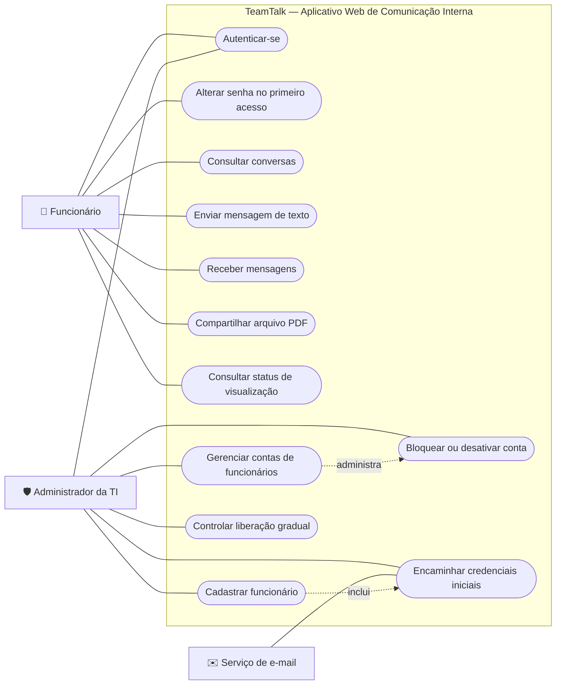

# Diagrama de caso de uso — TeamTalk

## Objetivo

Apresentar, de forma geral, o que cada perfil pode realizar no TeamTalk. O sistema possui dois atores principais: **Funcionário** e **Administrador da TI**. O serviço de e-mail é representado como ator externo porque participa do envio das credenciais iniciais.

## Diagrama

## Descrição dos atores

| Ator | Responsabilidade |
|---|---|
| **Funcionário** | Acessa a plataforma com credenciais individuais, conversa com usuários autorizados, compartilha PDFs e consulta o status de visualização das mensagens. |
| **Administrador da TI** | Cadastra e administra contas, controla bloqueios e desativações e coordena a liberação gradual dos usuários. Também utiliza a autenticação como usuário autorizado. |
| **Serviço de e-mail** | Sistema externo utilizado para encaminhar as informações iniciais de acesso ao funcionário. |

## Observações

- O cadastro público não existe: a criação de contas é exclusiva da equipe de TI (RF04, RN01 e RN02).
- No primeiro acesso, o funcionário precisa trocar a senha antes de utilizar as funcionalidades de comunicação (RF06 e RN04).
- O compartilhamento de arquivos é limitado a PDF (RF11 e RF12).
- O diagrama não inclui chamadas, áudio, imagens ou outros recursos fora do escopo inicial.
- A administração de contas deve ser protegida por autorização no servidor, e não apenas pela ocultação de opções na interface (SEG04).
