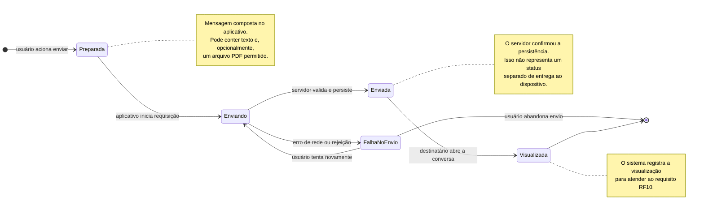

# Diagrama de máquina de estados — ciclo de vida da mensagem

## Objetivo

Representar os estados pelos quais uma mensagem passa no TeamTalk. O fluxo mostra a tentativa de envio, a confirmação de gravação pelo servidor, a visualização pelo destinatário e o tratamento de falha.

## Diagrama

## Estados

| Estado | Significado |
|---|---|
| **Preparada** | O usuário terminou de compor a mensagem e acionou o envio. |
| **Enviando** | O aplicativo está encaminhando a mensagem ao servidor por conexão segura. |
| **Enviada** | O servidor validou a operação e persistiu a mensagem. |
| **Falha no envio** | A tentativa não foi concluída, por exemplo, por falha de conexão ou rejeição de validação. |
| **Visualizada** | O destinatário abriu a conversa e o sistema registrou a visualização. |

## Eventos e condições

- **Enviar:** inicia a tentativa de envio.
- **Confirmação do servidor:** leva ao estado Enviada quando a mensagem é aceita e persistida.
- **Falha de rede ou validação:** leva ao estado Falha no envio.
- **Tentar novamente:** inicia uma nova tentativa após uma falha.
- **Abrir conversa:** quando o destinatário visualiza a mensagem, o estado passa para Visualizada.

## Regras importantes

1. O servidor deve validar a sessão e a autorização do usuário antes de aceitar a operação (SEG04).
2. Se houver arquivo anexado, o conteúdo real, o tipo e o tamanho devem ser validados; a extensão do arquivo, sozinha, não é suficiente (RNF11 e SEG05).
3. O estado Enviada significa que o servidor confirmou a persistência. O documento de requisitos não especifica um estado independente chamado Entregue; por isso, ele não foi inventado neste diagrama.
4. A visualização deve ser registrada e disponibilizada conforme as permissões de acesso (RF10, RNF12 e SEG04).

## Rastreabilidade

RF08, RF09, RF10, RF11, RF12, RF14, RNF06, RNF08, RNF11, RNF12, SEG03, SEG04, SEG05 e SEG06.
