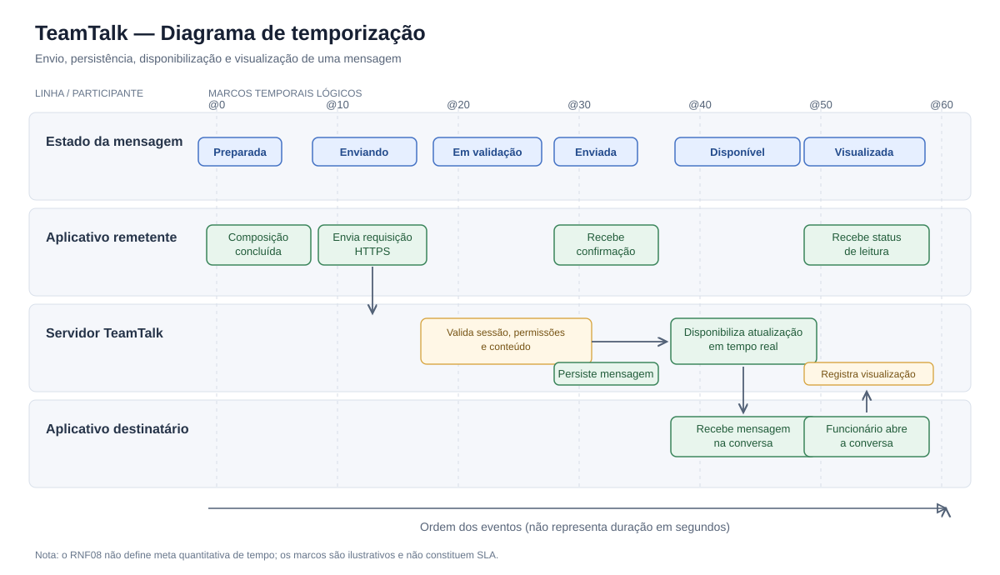

# Diagrama de temporização — TeamTalk

A imagem abaixo é o diagrama de temporização em formato SVG. **Ela aparece diretamente nesta página do GitHub**, no navegador, sem precisar instalar ou abrir outro aplicativo.

> **Importante:** os marcos @0 a @60 representam apenas uma ordem temporal lógica. Não são segundos, duração medida nem SLA. O RNF08 não define uma meta quantitativa de tempo.

## Código-fonte PlantUML

O arquivo [03-temporizacao.puml](03-temporizacao.puml) mantém a versão editável do diagrama em PlantUML, para quem quiser modificar a estrutura ou gerar outra versão.

Assim, esta documentação oferece:
- **SVG:** visualização pronta diretamente no GitHub, sem ferramenta externa.
- **PlantUML:** código-fonte editável do diagrama UML.
