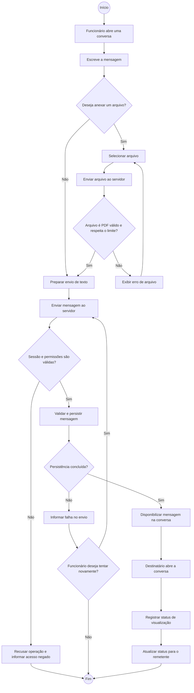

# Diagrama de atividades — envio de mensagem

## Objetivo

Descrever o fluxo realizado por um funcionário para enviar uma mensagem no TeamTalk. O processo contempla texto e anexo PDF opcional, validações de segurança no servidor e os caminhos de sucesso e erro.

## Diagrama

## Etapas do processo

1. **Composição:** o funcionário abre uma conversa e escreve o conteúdo da mensagem.
2. **Anexo opcional:** se selecionar um arquivo, o servidor verifica se o conteúdo é realmente PDF e se respeita o limite de tamanho definido pelo projeto.
3. **Autorização:** antes de executar a operação protegida, o servidor valida a sessão e as permissões do usuário.
4. **Persistência:** a mensagem é armazenada. Em caso de falha, o sistema informa o problema e permite uma nova tentativa.
5. **Disponibilização:** após a confirmação do servidor, a mensagem fica disponível na conversa do destinatário.
6. **Visualização:** quando o destinatário abre a conversa, o sistema registra e atualiza o status de visualização.

## Regras e decisões

- **Anexo opcional:** mensagens podem ser enviadas somente como texto ou com PDF.
- **Arquivo inválido:** formatos diferentes de PDF ou arquivos que não atendam às validações são recusados (RF11, RF12, RNF11 e SEG05).
- **Acesso negado:** uma sessão ausente, vencida ou sem permissão não pode enviar a mensagem (RF14 e SEG04).
- **Falha de persistência:** o usuário é informado e pode optar por tentar novamente.
- **Visualização:** o status só muda para Visualizada quando o destinatário efetivamente abre a conversa, conforme RF10.

## Observação de escopo

O fluxo não representa envio de notificações push, imagens, áudio, chamadas ou documentos em outros formatos, pois esses itens não estão definidos como funcionalidades do MVP.

## Rastreabilidade

RF06, RF08, RF09, RF10, RF11, RF12, RF14, RN04, RN05, RN06, RN08, RNF11, RNF12, SEG03, SEG04, SEG05 e SEG06.
